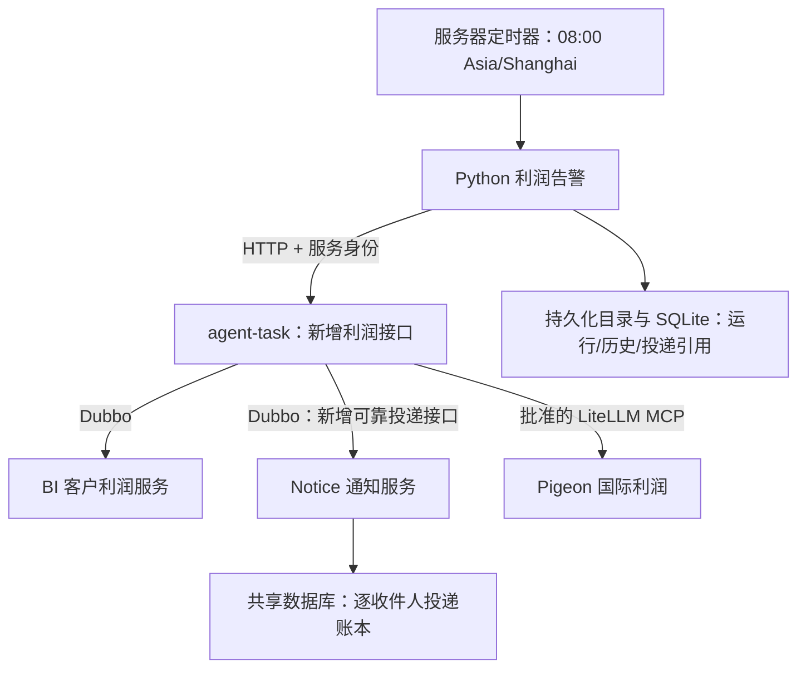

# 企业客户利润异常告警：最小上线方案

日期：2026-11-27｜版本：评审稿 v1.0｜范围：方案与契约，不表示接口已实现或已上线。

配套文档：[A/B 分工](02-AB分工.md)、[接口对接约定](03-接口对接约定.md)。A/B 是职责代号，不代表已经指定实际人员。

## 1. 目标与架构

每天北京时间 08:00 处理前一个完整自然日，使用公司身份独立取数、计算和通知。保留当前利润算法、阈值、卡片业务内容和正式收件范围。零业务告警不发业务卡片。

首期不接入、不修改 agent-runtime；启动、超时、单实例锁和漏跑检测由服务器调度承担，业务阶段及恢复由 Python 承担。不得同时启用 Runtime 和服务器两套执行入口。

业务类型 automation；编排 fixed_scheduler + application_workflow；运行 scheduled_job。无需运行时模型或 DeerFlow。

## 2. 代码核对结论

| 项目 | 当前事实 | 最小处理 |
|---|---|---|
| 利润告警 | 核心计算、历史、卡片、校验已有；取数/发送依赖个人环境 | 保留业务实现，替换三个外部适配点，补固定入口与状态 |
| agent-task | 账单策略、Run/Task、HMAC；利润接口不存在 | 新增独立利润 Controller/Service 和 Dubbo/MCP 客户端，不复用账单 execute |
| BI | CustomerProfitReportService.query 支持分页与日期，提供运营/销售及含税/不含税金额 | 复用只读服务，补齐等价字段映射与客户范围 |
| Notice | sendCardMessage 只入 Redis；消费先出队；响应仅日志，无业务回执 | 新增可靠逐人投递接口，保留旧接口兼容 |
| Runtime | 固定 runId 轮询，只注册账单邮件 Handler | 首期不参与 |

当前目录及五个项目均无 Git 元数据；文档中的 GitHub 来源链接不是本地远程关联。发布前为各修改项目取得正式仓库、记录提交；不得把目录名中的摘要当作已验证提交。

## 3. 最小改造项

### A：Java 服务端

1. agent-task 引入 BI/Notice API 和所需 Dubbo 配置，新增 `/internal/profit-alert/v1` 接口族；由 A 集成公司私有 Maven 依赖和服务注册发现。
2. 国内接口调用 BI query，执行筛选、税基和运营利润映射，返回 Python 兼容的逐页事实与总数。不直接重写 BI SQL。
3. 国际接口使用公司凭据调用既有批准的 LiteLLM MCP；保存原始回执，保留来源及完整性证据，不使用其他来源替代。
4. Notice 新增原始 Card 2.0 JSON 投递入口、持久化幂等账本、逐人消息 ID、查询与回读。新接口不走旧的无回执 Redis 队列；首期采用逐人同步尝试发送，状态查询完成恢复，无需新建队列。
5. agent-task 统一暴露 HTTP，机器人凭据留在 Notice；取数凭据留在对应服务；服务身份与权限校验在服务端完成。

### B：Python 与部署

1. 国内 query 的 request_fn 改成 HTTP 客户端；国际 fetch 改从 agent-task 获取回执；sender 改发送卡片并轮询/回读。
2. 保留构建历史、异常计算、卡片和治理校验；扩展投递配置与测试模式校验，新机器人/接口来源信息按规则治理发布新版本，不原地改不可变文件。
3. 新增单入口：校验规则→锁定数据日和模式→选择兼容历史→连续补国际日回执→国内历史及当日取数→计算/卡片→发送/回读→校验→提交 SUCCESS。
4. SQLite 记录数据日、模式、发布/规则/输入摘要、阶段、错误、产物位置及服务端 deliveryId；产物放持久化目录并备份。仅支持单主机单实例，SQLite 不放共享网络盘。
5. 配置 Python 3.11+ 镜像、锁定依赖、08:00 调度、进程超时、退出码、独立漏跑检测和运维通知。异常退出不等于业务完成。

参考职责层次：身份/网络/数据库为 L1；部署与运行记录为 L2；受控 HTTP/Dubbo 调用为 L3；数据日、计算、业务成功及恢复为 L4。首期不增加通用工作流平台。

## 4. 数据与恢复约束

- 全链路 Asia/Shanghai。国内适配采用半开区间 [起日00:00, 结束日次日00:00)，BI 实现的 endTime 是严格小于。
- Python 国内数据范围沿用现有 current_day-60 至 current_day；实际为含首尾的日期区间，不擅自缩短。
- 不把 BI smsOperateProfit 与旧接口 smsProfit 的等价性当作已确认；A 提供映射和同输入对账，业务核对通过才启用。
- 首跑必须导入合法 previous-history，或通过授权数据构建满足现有校验的初始历史；不得空历史填零启动。国际断档逐日补输入，不自动补发历史通知。
- 正式通知以“业务应用+数据日+正式模式+收件人稳定身份”为唯一槽位；规则和卡片摘要属于绑定内容。规则升级或卡片变化不得形成第二次自动发送。
- Notice 账本是投递权威记录，Python SQLite 是编排记录。部分成功只恢复未完成收件人；已确认消息不重发。
- SUBMITTING/UNKNOWN 先查权威记录；没有可靠查证能力时停住并交人工，不把超时当作失败重新发送。HTTP 重试不得重置飞书幂等期限。
- 成功要求：输入完整、计算和产物校验成功、所有应投递消息回读匹配。零告警保存零消息回执。HTTP 200/202 或入队成功不能替代业务成功。
- 生产槽位记录及其绑定摘要首期不自动删除；详细客户数据按公司留存要求清理。后续确定保留期时必须继续防止旧日重放。

## 5. 发布步骤与验收

1. A/B 冻结 v1 契约和样例；先用合成输入及模拟输出开发。
2. A 提供测试地址、身份和接口；B 用同一授权输入比较新旧利润、异常名单、趋势及卡片内容。
3. 完成缺页、缺金额、日期/来源错误、权限拒绝、重复触发、规则变化、部分发送后重启、未知投递、磁盘故障和备份恢复测试。
4. 按原交接要求连续一周试运行：旧环境保持正式通知，新环境仅发带标识测试消息给确认的测试人员。零告警的试运行状态通知与业务卡片分开记录。
5. 切换前暂停旧调度并确认无发送进程；核对未知消息；迁移历史与发送状态；只开启公司环境唯一调度。技术和业务切换结论分别留档。
6. 故障优先停止发送、保留账本并修复或回退代码；回退不得回退/删除投递账本，也不得自动重启个人旧任务。

## 6. 上线依赖及证据

| 缺口 | 负责 | 解除条件 |
|---|---|---|
| 公司私有依赖、Dubbo 服务可达性 | A | 测试环境实际调用成功 |
| 国内利润字段、客户范围、名称与日期转换 | A 主责，B 对账 | 映射表和同输入差异解释通过 |
| 公司 MCP 工具权限、日回执完整性 | A | 公司身份独立取数成功 |
| 机器人身份、名单解析、回读权限 | A | 测试投递和回读通过 |
| 首跑历史和旧投递状态 | B，业务提供授权 | 校验通过、最后已通知日明确 |
| 服务器、磁盘、监控与备份 | B | 重启/备份恢复/漏跑演练通过 |
| 2027 年日历 | B 准备，业务确认 | 跨年前发布新规则版本；当前覆盖到2026-12-31 |

本轮已有证据：静态治理校验和核心50项离线测试通过。未验证：新增接口、Java 编译、真实服务取数、真实投递及部署。本方案不声称上述依赖已落实。排期由 A/B 根据内部依赖可用性确定。
